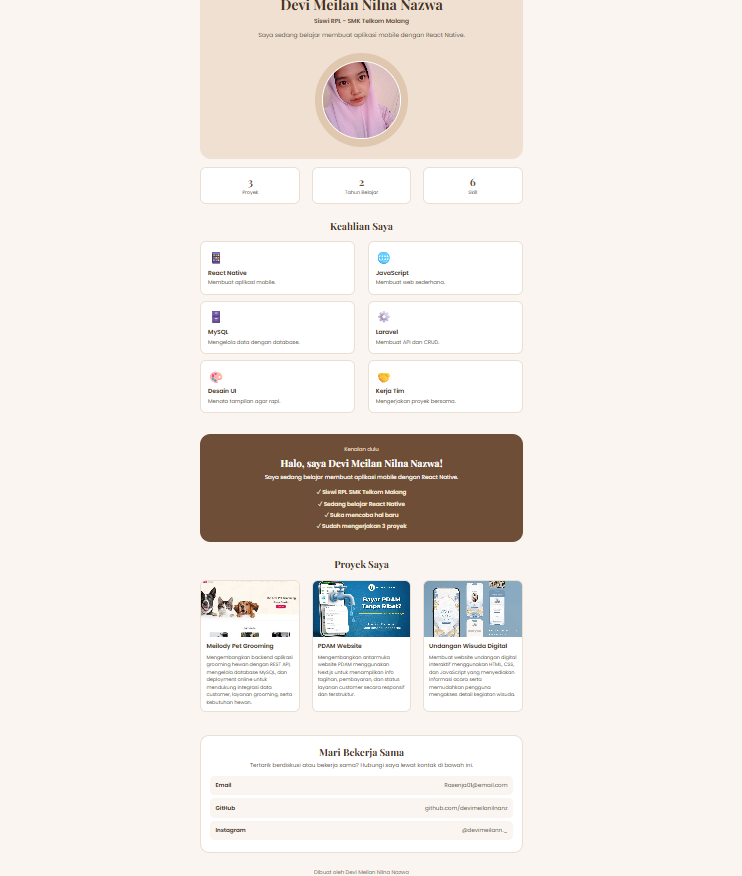
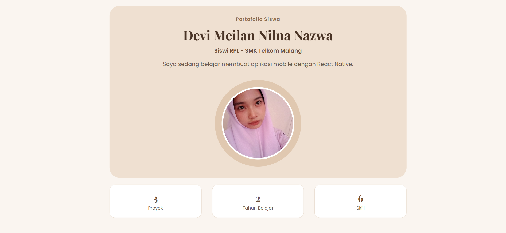
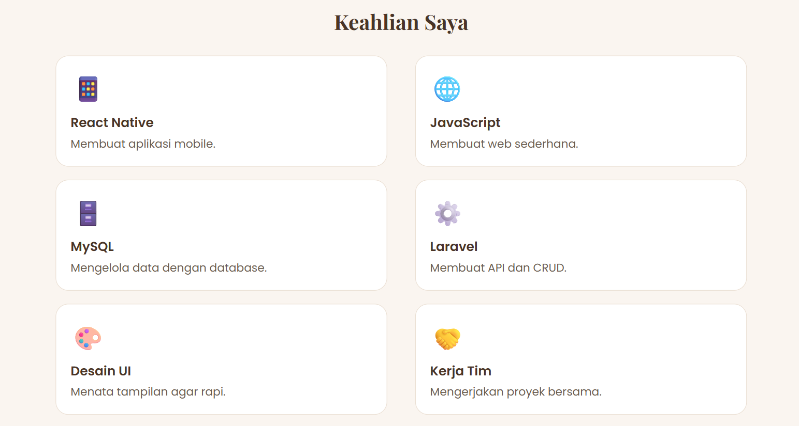
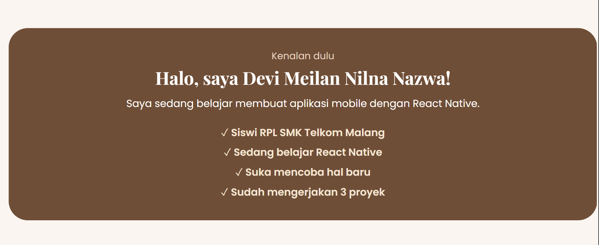
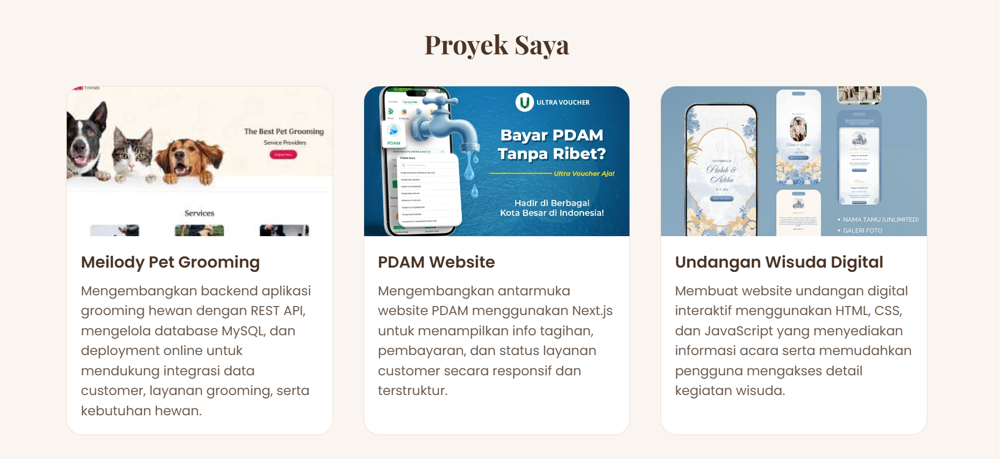
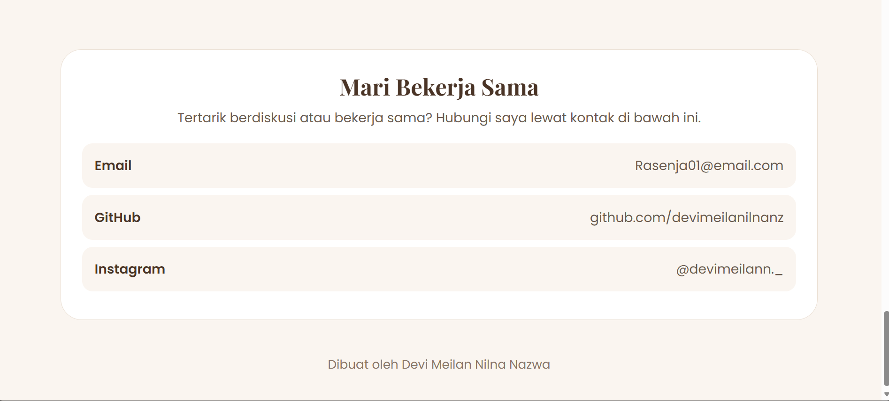

# Portofolio Saya

Landing page portofolio yang dibuat dengan **React Native (Expo)** dan **TypeScript** sebagai tugas sekolah. Halaman ini menampilkan profil, keahlian, proyek, dan kontak.

## Tampilan

### Tampilan website


### Bagian Atas


### Keahlian


### Tentang Saya


### Proyek


### Kontak


## Fitur

- Menggunakan 8 component yang bisa dipakai ulang
- Data dinamis: semua isi halaman diambil dari satu file data
- Menggunakan props untuk mengirim data ke tiap component
- Tampilan berwarna coklat dengan font Playfair Display dan Poppins

## Teknologi

- React Native
- Expo
- TypeScript

## Struktur Folder

```
portofolio-simple/
├── App.tsx                 → menyusun semua component
├── assets/                 → foto dan gambar proyek
├── components/             → component (Hero, StatKartu, ProjectCard, dan lainnya)
├── data/dataPortfolio.ts   → data dinamis
└── screenshots/            → screenshot tampilan untuk README
```

## Cara Menjalankan

1. Install [Node.js](https://nodejs.org) (versi LTS)
2. Download atau clone project ini
3. Buka terminal di folder project, lalu jalankan:

```
npm install
npx expo start
```

4. Tekan `w` untuk membuka di browser, atau scan QR code dengan aplikasi Expo Go di HP.

## Cara Mengganti Data

Buka file `data/dataPortfolio.ts`, lalu ubah nama, deskripsi, skill, proyek, dan kontak. Tampilan akan ikut berubah tanpa mengubah component.

## Pembuat

Devi Meilan Nilna Nazwa  
Siswi RPL - SMK Telkom Malang